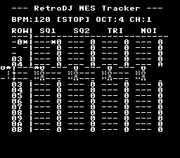
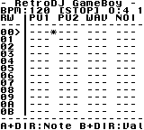

# RetroDJ (RDJ)

[](https://github.com/M5Devs/RetroDJ/actions/workflows/build-genesis.yml)
[](https://github.com/M5Devs/RetroDJ/actions/workflows/build-nes.yml)
[](https://github.com/M5Devs/RetroDJ/actions/workflows/build-gameboy.yml)
[](https://github.com/M5Devs/RetroDJ/actions/workflows/build-sms.yml)
[](https://www.gnu.org/licenses/gpl-3.0)

> **Universal, bare-metal chiptune tracker written in C.** Real-time hardware sound
> chip synthesis via direct register writes across vintage retro consoles and
> computers. No sample playback. No bulky ROMs. Pure silicon.

RetroDJ is a tracker that runs *on the console itself*. Every note you enter is
synthesized live by the machine's own sound chip — FM operators on the Genesis,
pulse/triangle/noise on the NES, the wavetable APU on the Game Boy, and the
SN76489 PSG on the Master System and Game Gear. There is no PCM sample bank and
no software mixer; the tracker simply programs the silicon, so what you hear is
exactly what the hardware produces.

---

## Visual Showcase

| Nintendo Entertainment System | Nintendo Game Boy |
| :---: | :---: |
|  |  |
| `BPM:120 [STOP] OCT:4 CH:1` | 4-channel tracker grid |

---

## Supported Platforms

| Platform | Hardware Chip | Synthesis Type | Channels | Target Output |
| :--- | :--- | :--- | :--- | :--- |
| **Sega Genesis / Mega Drive** | Yamaha YM2612 (OPN2) | 4-Operator FM Synthesis | 6 FM | `targets/genesis/out/rom.md` |
| **Nintendo Entertainment System** | Ricoh 2A03 APU | Pulse, Triangle, Noise | 4 APU | `targets/nes/out/rom.nes` |
| **Nintendo Game Boy / Color** | Sharp SM83 Sound Controller | Dual Pulse, Wavetable, Noise | 4 Ch (CGB Palettes) | `targets/gameboy/out/rom.gbc` |
| **Sega Master System** | Texas Instruments SN76489 | Square Waves + Noise | 4 PSG | `targets/sms/out/rom.sms` |
| **Sega Game Gear** | Texas Instruments SN76489 | Stereo-Panned Square/Noise | 4 PSG Stereo | `targets/sms/out/rom.gg` |

---

## Gamepad Controls

| Input Combo | Action |
| :--- | :--- |
| **D-Pad** | Navigate grid rows, channels, and sub-columns |
| **A + UP / DOWN** | Transpose note by +/- 1 semitone (auto-audition) |
| **A + LEFT / RIGHT** | Transpose note by +/- 1 octave / 12 semitones (auto-audition) |
| **B + UP / DOWN** | Increment / decrement instrument, volume, or FX by 1 |
| **B + LEFT / RIGHT** | Rapid increment / decrement value by 16 (`0x10`) |
| **B + A** | Clear / delete current cell (`---`) |
| **START** (or PAUSE on SMS) | Play / Pause pattern playback |

Notes are auditioned the moment they are entered or edited, so you hear the
hardware chip respond as you build a pattern.

---

## Architecture & Philosophy

RetroDJ is built on a thin, portable core with per-console hardware adapters.

- **Pure C99 + assembly abstraction.** Two small interfaces separate the tracker
  from the metal:
  - `rdj_driver_t` (`core/rdj_driver.h`) — the *sound driver* contract
    (`init`, `reset`, `note_on`, `note_off`, `write_reg`, `shutdown`).
  - `rdj_backend_t` (`core/rdj_backend.h`) — the *hardware backend* contract
    (`write_ym2612`, `write_apu`, `write_psg`, `wait_frame`, ...).
  Each target binds one driver to one backend, so the sequencer and UI are
  shared across every platform.
- **Strict zero-allocation guarantee.** No `malloc`. No heap. All state lives in
  static/`BSS` buffers sized at compile time, which is what makes the tracker fit
  in a 32 KB cartridge.
- **Direct register synthesis.** Notes are written straight to chip registers
  (YM2612 ports, NES `$4000-$4017`, GB `NRxx`, SN76489 latch/data bytes); the
  audio you hear is generated by the silicon, not by a sample engine.
- **GPLv3 copyleft.** The license protects open-source hardware tracking against
  closed-source commercial exploitation.

### Repository layout

```
core/        Portable tracker core (sequencer, driver/backend contracts)
drivers/     Sound-chip drivers (ym2612, nes_2a03, gb_sound, sn76489)
backends/    Hardware + host backends (per-console, null, VGM, serial)
targets/     Per-console main/UI and Makefiles (genesis, nes, gameboy, sms)
tests/       Host-side unit tests (run on PC, no hardware required)
screenshots/ Reference renders for the README gallery
```

---

## Building from Source

Each target has its own toolchain and `Makefile`. Build a single console with:

```bash
# Sega Genesis / Mega Drive  ->  targets/genesis/out/rom.md   (SGDK)
make -C targets/genesis/

# Nintendo Entertainment System  ->  targets/nes/out/rom.nes  (cc65)
make -C targets/nes/

# Nintendo Game Boy / Color  ->  targets/gameboy/out/rom.gbc  (GBDK-2020)
make -C targets/gameboy/

# Sega Master System  ->  targets/sms/out/rom.sms             (SDCC)
make -C targets/sms/

# Sega Game Gear  ->  targets/sms/out/rom.gg                  (SDCC)
make -C targets/sms/ GG=1
```

### Toolchains

| Target | Toolchain | Install |
| :--- | :--- | :--- |
| Genesis | **SGDK** (m68k-elf-gcc) | `docker pull ghcr.io/stephane-d/sgdk:latest`, then `docker run --rm -v "$PWD/targets/genesis":/src -u $(id -u):$(id -g) ghcr.io/stephane-d/sgdk:latest` |
| NES | **cc65** | `sudo apt-get install -y cc65` |
| Game Boy | **GBDK-2020** (4.5.0) | `wget https://github.com/gbdk-2020/gbdk-2020/releases/download/4.5.0/gbdk-linux64.tar.gz && tar -xzf gbdk-linux64.tar.gz -C /opt` (expects `/opt/gbdk`) |
| SMS / Game Gear | **SDCC** | `sudo apt-get install -y sdcc` |

### Host tests

The tracker core, drivers, and backends also build and run on a PC with plain
`gcc`, so the logic can be tested without any hardware:

```bash
gcc -std=c99 -Wall -Wextra -Werror \
  tests/test_main.c \
  drivers/ym2612/ym2612_rdj.c drivers/nes_2a03/2a03_rdj.c \
  drivers/gb_sound/gb_rdj.c drivers/sn76489/sn76489_rdj.c \
  backends/backend_null.c backends/backend_vgm.c backends/backend_serial.c \
  backends/backend_genesis_hw.c backends/backend_gb_hw.c \
  targets/genesis/src/ui.c targets/genesis/src/input_mapper.c \
  -I. -Icore/ -o test_runner && ./test_runner
```

---

## Releasing

Pushing a `v*` tag (or running the **Release** workflow manually) builds all five
ROMs and publishes them as a GitHub Release with a bundled
`RetroDJ-<tag>-ROMs.zip` archive. See `.github/workflows/release.yml`.

---

## License

RetroDJ is released under the **GNU General Public License v3.0**. See
[`LICENSE`](LICENSE) for the full text.

